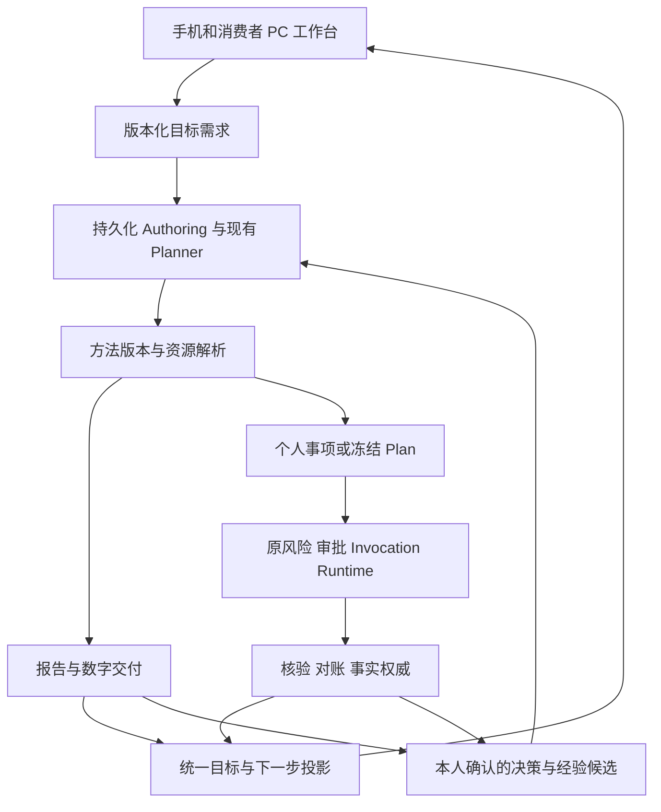

# Lazy Armor 项目全面检查分析 · 2026-10-12

2026-10-14最新：[Auth V2 M4-01 Web Passkey](AUTH_V2_M4_WEB_PASSKEY.md)开发切片完成：现有密码/已验证渠道近期证明、固定可信RP/Origin、强制UV与一次挑战、多密钥管理及移除/全Session撤销；凭据只查原UID，验签后原Session事务重查归属/公钥/计数/版本/期限。同步零计数与备份标志、行锁等待后的过期拒绝、登录/安全中心入口同步，原生不显示可提交入口。最终API343、Mobile460、Config104、Database31、CLI2共940项通过，8包类型/构建及最终API/Web/Android复验、真实Chrome虚拟认证器原UID流程通过；217密码凭据与含39条Passkey/23通知的15表恢复摘要一致。0097仅隔离test库、入口默认关闭，个人/生产和真实供应商未启用。正式RP/设备、Android/iOS、丢失全部渠道恢复、Web持久安全会话、原2 high/1 moderate依赖及0083发布证据门仍开放；完整Auth V2/Beta仍IN_PROGRESS。下一M4-02近期再认证与Web恢复/正式域名准备。以下为历史检查点。

2026-10-14最新：[M3-04防滥用与当前分析](AUTH_V2_M3_SMS_ABUSE.md)补齐服务端客户端/IP短期请求异常、多号码/IP/环境变化及日入场限制，SQL持久记录、费用预留前拒绝和按期限清理；标记可被修改，只作异常线索，不作硬件或账号证明。登录等待/原UID邮箱回退、隐私说明、停发短信保留邮箱和已有OTP通过。最终879项、类型/构建、Chrome与Android通过；168密码凭据及14表实际恢复一致。0096默认不开保护、只在test库执行，正式人机服务、设备/NAT误拦截、供应商送达/账单、号码恢复、Passkey、Web持久安全会话和2 high/1 moderate依赖、0083发布证据仍开放。当前仍为开发检查点，完整Beta/正式发布未达成；本文其余记录保留历史基线。

2026-10-14最新：[Auth V2 M3-03安全换号与当前分析](AUTH_V2_M3_PHONE_CHANGE.md)完成原账号/新号双证明、旧号码停用、全登录Session/恢复链接撤销、旧渠道安全通知及审计同事务；额外修复旧号码OTP解析后补发会话和安全中心缓存能力问题。最终838项、两种真实Chrome换号/原UID重新登录、原绑定/恢复、类型/构建与Android/Hermes通过，167密码凭据及含23条通知的12表非空恢复一致。通知仅排队或网关受理，不宣称运营商/邮件送达；默认关闭，个人/生产未0093/0094/0095或启用真实网关。停用原号不自动释放，部署前需0095且不能降级到忽略停用状态的旧认证。设备异常/防滥用、真实供应商/账单/通知核对、号码重新分配/全部渠道丢失恢复、Passkey、Web持久会话及前批2 high/1 moderate、0083发布门继续开放。本文其余内容保留历史检查点；完整Beta及生产发布仍未达到。

2026-10-13最新：[Auth V2 M3-02短信预算与故障恢复](AUTH_V2_M3_SMS_GUARDRAILS.md)新增0094持久额度/发送记录，号码60秒预留间隔与中国时区号码/IP/通道日额度、最高费用预留、默认独立停发与Gateway V2固定模板/回执验证；未知不退款/补发。请求Redis有限时限、关闭离线队列并在异常后重建连接，SQL/网关迟到结果不补发；页面读取真实等待时间，短信耗尽可切换已绑定邮箱。API目标加入构建缓存键，导出清理Metro并在隔离浏览器前核对目标。原认证206和本批专项37合计API243，Mobile448、Config73、Database31、CLI守卫2共797项通过；无缓存八包类型/构建、最后API复验与Android/Hermes通过。真实Chrome短信受限后已绑定邮箱进入原UID，真实Redis暖/冷黑洞及SQL锁等待拒绝、不补发；2个密码凭据及含新短信记录的11表非空恢复摘要一致。个人/生产0093/0094与真实网关未启用；正式送达/账单/设备异常、换号/丢失恢复、Passkey、Web安全持久会话及依赖2 high/1 moderate、0083正式发布门仍开放。下一M3-03安全换号，下文为历史时点。

2026-10-13最新认证切片：[Auth V2 M3-01手机号绑定](AUTH_V2_M3_PHONE_BINDING.md)已实现当前密码/已有已验证渠道OTP + 新号码OTP双证明；邮箱和手机号共用安全流程与两步表单，旧邮箱持久化证明兼容，目标唯一归属和审计同事务。安全中心按真实能力显示添加手机号，绑定后OTP/共享密码进入原User ID。额外修复同一OTP的尝试预算跨窗口重置，实际有效期内原子限制5次。最终联合API206、Mobile441、Config67、Database31、CLI守卫2共747项；八包类型/构建、Android/Hermes、真实Chrome和134个用户密码/9表非空恢复通过。默认绑定开关关闭且要求UNIFIED/已配置HTTPS短信网关；配置不证明真实送达，个人/生产未迁移或启用。下一M3-02为严格短信间隔、日额度/费用熔断与供应商契约；换号/丢失恢复、Passkey、旧表停写/Argon2、Web持久安全会话、依赖2 high/1 moderate与0083发布门仍开放。下文是历史时点。

检查始于 2026-10-12，报告整理与源码同步续接于 2026-10-13。

2026-10-13最新：[M2-03统一邮箱恢复与分析](AUTH_V2_M2_EMAIL_RECOVERY.md)补齐新增邮箱恢复用户级密码，认证密文固定渠道/凭据版本，SQL HMAC阻止旧读者解释新链接；签发/消费预算、回滚/全登录会话撤销、旧链接拒绝和已登录入口已验证。701项与97用户密码/9表非空恢复、真实Chrome、类型/构建和Android/Hermes通过。零新SQL及个人/生产写入，默认兼容模式不宣称已灰度；M3手机号/正式供应商、换号、Passkey、旧表停写/Argon2、Web安全持久会话、本人真机和2 high/1 moderate依赖、0083正式发布门继续开放。下文“新增邮箱恢复尚未实现”为历史时点。

2026-10-13最新：[Auth V2 M2-02新邮箱绑定与分析](AUTH_V2_M2_EMAIL_BINDING.md)完成当前账号/新邮箱双证明、会话/凭据版本隔离、唯一归属锁与事务审计，安全中心和绑定页面同步；密码和无密码两条真实Chrome旅程进入原User ID。最终648项、类型/构建、Android/Hermes及52个用户密码/9表非空恢复通过。本批无新SQL或个人/生产写入；新增邮箱密码恢复、正式迁移/灰度、短信/换号、Passkey、Web安全持久会话和本人真机仍开放。依赖2 high/1 moderate与0083正式发布证据门保留。下文“绑定未实现”等为历史时点，不作为本批最新状态。

2026-10-13后续：[Auth V2 M2-01兼容迁移](AUTH_V2_M2_PASSWORD_CREDENTIALS.md)新增用户级密码表与0093，默认旧路径不变；Shadow/Unified范围内保持原User ID，已验证手机号共用密码、版本/归属重查与事务审计通过。611项自动/隔离回归、CLI重跑和20用户密码/9表非空恢复通过，真实供应商及本人真机不由此替代。个人库仅只读审计、尚未0093；生产迁移/绑定/旧表停写、原依赖2 high/1 moderate及0083发布门继续开放。

2026-10-13第四批：[Auth V2 Beta 验收与当前分析](OPTIMIZATION_BATCH_04_AUTH.md)统一邮箱新写入和本人旧邮箱验证，保持原 User ID；修复密码重置原子性及旧请求会话补发，刷新保留聊天草稿，登录/安全中心/恢复入口同步。只读本地映射清单无冲突，但10个旧密码邮箱待本人验证。本文身份与刷新缺陷行保留历史基线，正式环境历史处理、手机号正式服务、Passkey 与原发布门仍待；本批具体验证与限制以新记录为准。

2026-10-13后续：[S0首批整改](OPTIMIZATION_S0_BATCH_01.md)修复API类型、Connector回归与备份目标隔离，类型/构建各8/8、350项回归及真实隔离dump/restore通过。本文保留8307b1d历史发现和当时线号，其他安全/发布/体验问题未整体关闭。

2026-10-13第二批：[Admin访客鉴权验收](OPTIMIZATION_S0_BATCH_02_ADMIN_AUTH.md)已修复共享令牌代理全部访客的入口。原身份/角色与会话撤销复核、登录/退出和浏览器Cookie隔离通过，68项回归及API/Admin构建通过。本文Admin缺陷行是历史基线；依赖、正式发布、身份一致性、恢复与交互问题继续开放。

2026-10-13第三批：[生产依赖处置](OPTIMIZATION_S0_BATCH_03_DEPENDENCIES.md)已升级5项有补丁依赖，最新审计0 critical/2 high/1 moderate，原high发布门仍exit1。521项回归、全仓类型/实际构建及隔离API/Android JS导出通过；无补丁node-forge/braces/sprintf-js继续开放。本文旧2 critical/5 high数量为历史基线，不能作为最新结果。

本次检查覆盖当前工作区的 API、移动端、Admin、共享合同、数据库迁移、执行与生成恢复、CI、依赖、产品状态和本地验收记录。结论基于源码、重新执行的检查及历史证据复核；没有把历史部署状态当作当前运行状态。

**总体判断：核心架构已成形，部分产品旅程有真实证据，当前工作区仍是开发检查点，不具备正式发布条件。** 优先工作应转向构建收口、身份一致性、恢复安全和完整用户旅程。继续增加模块名称不会解决这些问题。

**实际架构与价值**

项目使用 pnpm/Turbo monorepo、NestJS 模块化单体、MySQL/Drizzle、Redis/BullMQ、Expo/React Native 与 Next.js Admin。源码约有 132 个数据库表定义、75 个 Controller，API、执行 Worker、Outbox Worker 具有独立进程入口。业务范围较广，复杂度已超过普通聊天应用。

值得保留的设计包括：外部副作用统一走原审批与执行链；未知结果保持独立历史并通过只读核对恢复；Authoring 有持久租约、期限、尝试限制与最终事务栅栏；方法冻结具体版本和内容 hash；主要 Consumer/Memory 接口实施 owner 隔离；报告交付、模型判断与现实 Truth 分开表达；学习由本人确认且来源可撤回。没有发现需要把这些职责拆成多个微服务的依据。

**功能完成度**

| 范围 | 当前可以认可的成果 | 仍欠缺的能力或验收 |
| --- | --- | --- |
| 五页主体验 | 日程、计划、会话、资源、服务及目标/WorkItem 投影已接入 | 完整联合 Beta、持续运行、后台系统送达和正式发布 |
| V91 目标与持久化生成 | GoalBrief、生成队列、取消、版本变化和恢复；荆门报告的预算修订、离开/重启找回、本人查看已有真机记录 | 跨领域需求、配额、公平队列、性能；报告不证明当地市场事实 |
| V92 决策与学习 | 本人决定保存→后续理解→来源找回有真机子闭环；核验结果到经验候选已有受控实现 | 真实经验接受、更广结果适配、多样本评估、长期效果 |
| V93 方法组合 | 结构预览、规划交接、固定公开来源、持久预算、逐节点输入输出与前缀恢复 | 通用 Runtime Recipe、实际多资源执行/补偿、真实资源故障恢复、本人完整多方法旅程、人民币预算 |
| V94 消费者 PC 工作台 | 三栏目标空间、报告历史、下一步；复用 Consumer API，与 Admin 分开 | 稳定 PC 会话、Web 确认组件、专业排版/比较、认证后的视觉和跨端旅程 |
| 早期执行线 | 日历等链路保留详细历史验收，源码有签名、epoch、PREPARED 日志及只读恢复设计 | 本轮没有重跑手机副作用、实际第三方、七天运行或生产迁移 |

V93 的真实 DeepSeek 隔离案例以及真实 SQL/Redis 子进程恢复记录已复核。它们分别证明文本加工和 fixture 模型下的持久恢复，不证明真实外部工具、多资源语义正确性或本人手机组合旅程。新增 `composition-runtime-compiler.ts` 尚无调用方，且存在类型错误，不能算已交付的通用组合执行能力。

**优先问题与证据**

下列 P1 表示应优先修复或作为发布阻断处理；P2 表示影响正确性、体验或恢复可靠性。源码确定、mock 复现与尚未实测的并发风险分别说明。

| 优先级 | 问题 | 证据与判断 |
| --- | --- | --- |
| P1 | 当前 API 无法通过类型检查 | `composition-runtime-compiler.ts:2` 导入未导出的 `compositionRuntimeCompilationSchema`；第 74 行的 `runtimeCompilation` 不属于 `PlannerResult`；第 73/91 行还有隐式 any。重新执行全仓 typecheck，API 报 4 错，7/8 包成功。 |
| P1 | 备份演练的隔离保护可能误删主库 | `packages/database/src/backup-restore-gate.ts:122` 只匹配 `backup|restore|test` 子串，`lazy_armor_latest` 也通过；第 87/156 行随后直接重建指定库，未要求主库/备份库/恢复库互异。纯 mock 已捕获 `DROP DATABASE IF EXISTS lazy_armor_latest`，未连接真实 DB。 |
| P1（部署条件） | Admin 缺少页面访问者鉴权 | `apps/admin/app/page.tsx:58` 无条件加载运维数据；`operations-data.ts:28/45` 用服务端 ADMIN_ACCESS_TOKEN 代理 7 个接口。当配置有效令牌且页面对其他人可达时，访客可读运维数据。未证明当前已公网暴露。 |
| P1 发布阻断 | 生产依赖审计未过 | 本轮联网审计：2 critical、5 high、1 moderate；CI 的 high 门会失败。API 的 proxy-addr/sharp 与 Expo/RN 工具链告警需分开评估，不能把所有 advisory 当作已证明的线上利用。 |
| P1 发布阻断 | 0083 迁移发布证据缺失 | `scripts/check-migration-safety.mjs:123` 要求正式 release evidence；现有 CI 调用 migration:safety 未提供该证据。实际检查失败。0091/0092 的增量验证不能关闭历史 0083 门。 |
| P2 | 密码重置令牌可并发消费两次 | `apps/api/src/auth/auth.service.ts:260` 在事务外检查 usedAt；事务内仅按 ID 更新，没有原子领取或锁内复查。当前源码配合串行事务内存夹具，两个并发请求都成功并各写一次密码。 |
| P2 | 同邮箱验证码与密码注册可能分裂为两个账号 | `auth.service.ts:70` 密码注册只查 authIdentities，验证码首次注册在第 116–130 行只写 loginIdentifiers。先验证码注册再同邮箱密码注册会产生两个 user，随后两种登录进入不同数据空间。源码路径确定，未做本轮 SQL 实测。 |
| P2 | 正常 token 更新清空会话工作 | `apps/mobile/app/(tabs)/chat.tsx:39` 将 token 变化当作路由重置，清除输入/附件并恢复初始会话 ID。前台刷新在默认 15 分钟令牌到期前 2 分钟发生；同账号使用约 13 分钟即可触发。 |
| P2 | PC 决策/经验确认及部分删除按钮无效 | `personal-memory/report-decision.tsx:34`、`learning-review.tsx:34`、`edit.tsx:32` 只在 Alert 回调内提交；当前 react-native-web 的 Alert 是空实现。已核对依赖源码及 V94 导出产物。 |
| P2 | 长报告的健康时效与固定权威冲突 | `public-web.connector.ts:62` 健康有效期 5 分钟，`consumer-read-source.service.ts:20/37` 要求健康有效且完整健康行进入 authorityHash；报告允许 20 分钟并持续复查旧 hash。过期或正常健康续检会阻止较慢任务继续，未做真实慢模型复现。 |
| P2 并发风险 | 报告与 Consumer 锁顺序相反 | `report-generation.service.ts:70/73` 先消息后会话，`consumer.service.ts:301` 等路径先会话后消息；存在交错死锁环。本轮没有 SQL 死锁实测，不能表述为已复现故障。 |
| P2 验收缺口 | 恢复门未覆盖新持久状态 | backup-restore fixture/比较清单缺少 plan_goal_briefs、authoring_jobs、learning_candidates 的非空数据及 V93 预算/方法结果。MySQL 验收脚本也没有核对当前 93 条 journal/hash。现有 ok:true 不足以证明新增状态恢复完整。 |
| P2 工程回归 | Connector 合同测试仍固定旧数量 | `apps/api/test/p5-connector-contract.spec.ts:9` 期望 9 个适配器，实际为 10；本轮纯 API 套件唯一失败。应对预期目录和每个适配器合同进行明确校验，不只修改数量掩盖范围差异。 |

建议修复方式：构建错误补齐共享导出和 Planner 合同；重置令牌在事务内原子领取并检查受影响行数；邮箱登录身份统一唯一性和绑定；页面状态以稳定账号身份区分账号切换；Web 使用显式确认组件；将稳定授权身份与可续期健康证据分开；统一数据库锁顺序；备份门采用严格随机临时库名、三库互异及明确主机校验。

**依赖细节**

| 包 | 等级 | 已知更新方向与调用边界 |
| --- | --- | --- |
| proxy-addr 2.0.7 | critical | Express 实际依赖；修复版本 ≥2.0.8。API 可配置 trusted proxy，需审阅具体代理配置及 IP 安全逻辑。 |
| shell-quote 1.10.0 | critical | React Native devtools 路径；修复版本 ≥1.11.0。不能据此直接认定手机线上业务存在命令执行入口。 |
| sharp 0.35.4 | high | API 直接依赖；修复版本 ≥0.35.5，应结合图片/SVG 处理输入检查。 |
| node-forge、braces、compression、source-map-js | high | 分别核对运行时与工具链可达性、输入控制及上游兼容性；source-map-js ≥1.2.2、compression ≥1.8.2。 |
| sprintf-js | moderate | 核对是否处理不可信格式与精度。 |

审计只统计本次 `--prod` 扫描结果；没有进行漏洞利用或升级依赖。

**本次实际检查结果**

| 检查 | 结果 |
| --- | --- |
| 全仓类型检查 | 7/8 包成功，API 4 项错误；4 包使用 Turbo 缓存，其他实际执行。 |
| Mobile | 72 文件，434/434。 |
| Plan-schema | 56 文件，312/312。 |
| Config / Shared / Admin | 63/63、7/7、3/3。Database test 目录无测试，不能视为数据库回归通过。 |
| API 纯本地检查 | 按源码保守排除依赖 SQL/Redis/Nest 启动的文件：78 文件，503 通过、1 失败；不是全 API 集成套件。 |
| 发布/readiness 脚本单测 | 16/16。 |
| Migration segmentation | 93 个文件通过。 |
| repository:hygiene / data:truth / diff 空白 | 通过。卫生检查原脚本仅覆盖 Git 跟踪文件，推送前另检查本次新增文本。 |
| terminology:check | 检查初期因旧文档暂时缺失失败；后续工作区文档恢复，重新检查通过，共 974 个当前跟踪文件。 |
| migration:safety | 失败：0083 缺少正式 release evidence。 |
| 生产依赖 audit | 失败：2 critical、5 high、1 moderate。 |
| SQL/Redis 集成测试 | 未完成：Docker Desktop Linux 引擎不可访问，隔离集成 runner 在创建库前停止；没有生产迁移。 |
| 当前本地服务 | API 3001、execution 3011、outbox 3012 的只读端点均不可达；历史 ready 记录不能覆盖当前状态。 |
| 手机、浏览器画面、第三方与持续七天 | 本轮未新增实际验收；仅复核已有记录及源码。 |

上述可执行本地套件共 1339 项：1338 通过、1 失败，按本轮独立运行计数；不与历史回归数量累计，也不包含中止的基础设施依赖套件。首次按文件命名排除 integration 后，发现部分 `.spec.ts` 本身会启动数据库/Redis，因环境不可达已中止，随后改为保守选择纯本地文件。

关键本地日志保留在 `artifacts/project-audit-2026-10-12-*.log`；备份隔离的无数据库 mock 脚本为 `artifacts/project-audit-2026-10-12-backup-isolation-mock.cjs`。私有验收截图、凭据、原始报告及 SQL 备份不因这份分析而新增上传。

**工程与产品判断**

项目的主要优势是执行安全和来源追溯基础较扎实，并且已有少数正常用户入口的真实闭环。主要弱点是范围扩张快于发布收口：身份、PC、长任务健康和数据恢复仍有实质缺口，文档中的多个阶段都保持 IN_PROGRESS。当前不能给出有依据的整体完成百分比。

建议继续保留模块化单体，优先消除同一职责中的多套身份和状态判断。共享 Zod 合同是有效基础，但未接入文件也会被 TypeScript 编译；应将完整新功能以可构建的小检查点提交。已有 93 次迁移，需要把非空数据恢复、版本/租约/预算保留和原权威 hash 核对纳入发布验收。

建议下一轮按以下顺序推进：

1. 先恢复可构建、可回归的开发基线，并修复备份误删保护与 Admin 页面鉴权。
2. 收口邮箱身份和密码重置并发，再解决 token 轮换及 Web 确认组件。
3. 修复授权/健康时效和锁顺序，完成长报告、撤权、进程故障的隔离数据库验收。
4. 补 V91–V93 非空状态备份恢复，完成依赖处置和 0083 正式发布证据。
5. 再收取本人 PC/手机完整多方法旅程、真实资源执行与持续运行证据，决定 Beta 是否发布。

本次 GitHub 同步是用户授权的源码开发检查点，保留已发现的未完成实现与失败检查，不代表合并主分支或生产发布。

**旧文件清理范围与环境阻断**

`artifacts` 约 12.50 GiB，其中 40 个 APK 约占 8.69 GiB，截图约 2.58 GiB。经用户授权，已审阅 36 个未跟踪旧 APK 的路径、大小与 SHA256，计划释放 8,602,118,529 字节（约 8.01 GiB）。计划保留最新方法链、固定来源绑定、报告交付三个已安装版本作为回退点，以及计算器来源 APK；所有跟踪文件、验收截图/JSON、文档、SQL 备份与分析日志保留。

自动审批先后拒绝了按审阅清单删除以及明确列出 36 条绝对路径的 PowerShell 删除命令，两次均仅返回 `blocked by policy`。没有执行删除，也没有释放上述空间；清理目前未完成。完整候选清单保存在本机 `artifacts/project-cleanup-2026-10-12.json`，状态为 `BLOCKED_BY_POLICY_NO_FILES_DELETED`。该限制没有被其他工具或 shell 绕过。
