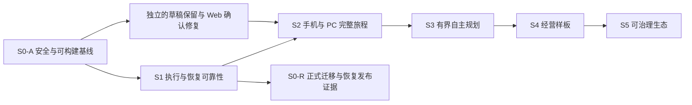

# 懒人装甲全面优化执行方案 V1.1

项目：Lazy Armor。规划日期：2026-10-13。源码核对基线：`codex/v83-persistent-runtime` / `8307b1d`。

依据：用户提供的综合评估、全面优化实施方案 V1.0、[项目检查报告](PROJECT_AUDIT_2026-10-12.md)及关键调用链只读核对。方案最初交付时未实施修复，后续整改进度见任务账本及验收记录。

本方案是 [Personal Life OS 总方案 V2](PERSONAL_LIFE_OS_MASTER_PLAN_V2.md) 的整改与交付附录。S0–S5 表示优化工作流，不替代 V91–V96 的功能版本或历史真实验收状态，不新增执行权威。

**1. 总体目标与实施边界**

把已有的目标理解、方法、资源、执行、报告与学习能力组合为一个可靠的用户产品：用户能提出目标、理解当前进展、作出必要决定、找回成果、核对结果，并在后续工作中使用本人确认的经验。

保留 Goal/Plan、USER_EVENT、Execution、Invocation、Outbox、Verification、Reconciliation、Truth 和 Memory 的原职责；新增编排只调用合法入口。继续采用现有模块化单体和三个进程角色。

手机主导航保持 **日程｜计划｜会话｜资源｜服务**。以页面内容和目标详情改善“今天做什么、AI 正在做什么、接下来谁处理”的表达。报告生成完成、执行成功、现实核实和目标成功分别展示。

模型可以提出需求解释、方法组合、任务图和修订建议；外部操作由服务端检查真实能力、输入范围、风险、预算、审批和版本。方法文件、网页与第三方文本不获得执行权或事实权威。

用户记忆保留来源、版本、确认与撤回。经营数据、日志和指标采用必要范围，不把一次结果变成普遍规律，不把示例数据写入个人真实状态。

**2. 基线判断与需要校正的说法**

| 事项 | 当前判断 | 后续怎样处理 |
| --- | --- | --- |
| 架构与产品基础 | 核心架构已形成，V91/V92 有真机子闭环；V93 报告链和 V94 工作台是部分交付 | 增量收口现有资产，以用户旅程与恢复证据验收 |
| 构建、安全与交互问题 | 上轮检查有 API 4 项类型错误、1 项 Connector 测试失败、依赖告警、备份与身份/页面问题 | 先逐项复现、最小修复、验证；新提交重新运行相关检查 |
| 队列任务滞留 | `removeOnFail:false`，而 `hasExecutionJob` 只检查存在；Reconciler 见存在即跳过，风险路径明确 | 用真实隔离 Redis 与数据库复现失败 Job/非终态 Execution，再决定恢复动作 |
| 首次就绪循环 | 投影以历史成功 Execution 判断管道就绪；但本次查到主要服务端编译调用均使用 DRAFT | 先核对启动/审批/派发实际入口；目前不能宣称所有新用户首次执行被阻止 |
| Planner 禁止词 | 当前对完整 JSON 执行子串扫描，合法 `daily_life.payment` 含 `pay` | 增加合法目标与恶意动作对照用例，改为结构化权限/动作检查 |
| CI 状态 | 当前 workflow 的 push 仅覆盖 main，PR 与 workflow_dispatch 是其他入口 | 开发分支推送不等于 CI 通过，需明确触发策略并核对运行 SHA |
| 0083 发布门 | 要求 staging/production、非本机数据库、HEAD SHA、备份恢复证据和确切迁移 hash | 本地 fixture 不能替代正式发布证据；保留该门与待验状态 |
| UI 评分与费用 | 历史截图评分是主观评价；当前没有可靠人民币总费用上限 | 采用实际任务测试与成本来源，不能写成实测评分或已实现硬预算 |

不按版本号、文件数或总测试数量计算产品完成百分比。源码确认、mock 复现、隔离数据库、真实模型、实际第三方和本人使用各自记账。

**3. 阶段顺序与依赖**

| 阶段 | 主交付 | 关闭所需证据 | 允许提前准备的工作 |
| --- | --- | --- | --- |
| S0 | 可构建、安全目标保护、页面鉴权、依赖处置、发布证据链 | 工程子门 S0-A 为当前提交 Typecheck/Build、相关回归与安全保护通过；正式子门 S0-R 待 S1 非空恢复完成后补真实证据，发布前强制通过 | UI 草稿/确认修复；S1 故障用例设计 |
| S1 | 邮箱身份、队列状态恢复、锁序、健康/授权分离、租约与数据恢复 | 独立 SQL/Redis/子进程矩阵通过，原操作身份与预算保留，未知结果不重复执行 | S2 设计系统与只读目标空间设计 |
| S2 | 手机/PC 同一目标的提出、审阅、修改、取消、找回与来源核对 | 认证后的浏览器及正常手机完成同一版本旅程，失败/等待状态正确 | S3 合同与只读规划评测；经营样板数据合同 |
| S3 | 相关性检索、有界任务图、合法编译、受控 Replan | 跨领域和无专用业务 Recipe 的评测目标可提出合法图；支持动作的真实链路与失败调整通过 | 已有报告链可承载经营只读分析草案 |
| S4 | 首个经营数据→分析→活动草案→核对效果的闭环 | 数据范围、计算、本人选择及结果可追溯；有可供第二目标复用的能力 | 行业适配器设计 |
| S5 | 版本化能力合同、质量证据、缺口反馈、跨目标复用 | 至少第二个目标/行业使用相同能力，禁用、升级、撤回和历史兼容通过 | 市场机制研究，成熟后再纳入独立任务 |

独立且低风险的修复可以先完成，阶段关闭仍要求全部必需证据。经营样板的读取与活动草案可复用现有报告能力；它不必等待所有开放式规划能力建成。任何新增自动外部操作仍依赖可靠性和原执行许可。

S0-A 通过允许继续实施 S1，不表示整个发布门已经关闭。FIX-05 需要 FIX-13 的恢复证据，因此把 S0-R 作为贯穿任务；若要求先关闭整个 S0 再开始 S1，就会形成不合理的依赖循环。开发检查可报告静态安全检查结果和发布证据待验，正式 staging/production 检查仍要求原完整证据，不能改成忽略失败。

每阶段先冻结范围和成功标准。缺少手机、第三方或正式发布环境时，继续可独立验证的工作，并保留具体待验项，不制造证据或反复验证已关闭范围。

**4. 缺陷任务账本：FIX-01–FIX-18**

表中的优先级是实施顺序，不把尚未复现的风险称为生产事故。2026-10-13首批FIX-03、FIX-17、FIX-01按冻结范围CLOSED，见[验收记录](OPTIMIZATION_S0_BATCH_01.md)；第二批[FIX-02 Admin访客鉴权](OPTIMIZATION_S0_BATCH_02_ADMIN_AUTH.md)范围CLOSED，68项相关回归及真实浏览器通过。第三批[FIX-04依赖处置](OPTIMIZATION_S0_BATCH_03_DEPENDENCIES.md)移除5项可补丁告警，521项回归及全仓类型/构建通过；剩余2 high/1 moderate无已发布补丁，FIX-04整体IN_PROGRESS，原high门exit1。其余任务保持PLANNED。

| ID | 优先级/阶段 | 实施范围与依赖 | 最小关闭条件 |
| --- | --- | --- | --- |
| FIX-01 | P0 / S0 | backup-restore-gate 严格临时库命名；主/备份/恢复三者互异；核对应用/管理目标主机端口；限制运行环境与管理权限；危险输入在连接前拒绝 | latest 子串、主库别名、同名两库、不同主机、系统库、非法标识均拒绝；真实隔离演练只改确切临时库；原库 hash 保持 |
| FIX-02 | P0 / S0 | Admin 服务端会话与原用户角色校验；复用 super_admin / operations_readonly，页面入口先验身份再读取数据 | 无 Cookie、伪造/过期/撤销会话、普通用户均无诊断数据；授权管理员可读；Cookie/刷新令牌不出现在网页脚本；保留审计 |
| FIX-03 | P0 / S0 | 补共享导出、PlannerResult 类型、schema 与 UI 兼容；核对组合编译文件接入范围 | 8 包 typecheck 和实际 build 通过；未接通编译器仍不能显示已执行；旧报告/目标可读 |
| FIX-04 | P0 / S0 | 按实际运行路径处置 production dependency audit；先 proxy-addr/sharp，再 Expo/RN 传递依赖，处理无可用补丁项 | 锁文件冻结安装、受影响运行回归、最新 high/critical 门结果与残余项可追溯；没有补丁或处置证据时保留发布阻断 |
| FIX-05 | P0 / S0 发布 | 保持 0083 append-only；完善针对当前 HEAD 的实际 staging 迁移、备份恢复和批准证据供给，连接 CI 校验 | 原检查器通过；environment/非本机 database/commitSha/backupRestoreGate/approvedMigrations hash 全部真实匹配；没有用 fixture 伪造批准 |
| FIX-06 | P1 / S1 | 重置令牌在单事务内原子领取 unused 且未过期行，校验受影响行数，密码修改和会话撤销同事务 | SQL 并发两个请求只成功一个；事务失败可合法重试；过期/重放失败；撤销原会话 |
| FIX-07 | P1 / S1 | 统一规范化邮箱身份绑定与唯一性；验证码先注册/密码先注册路径一致；形成历史冲突只读清单 | 两种注册顺序和并发只形成一个合法用户；绑定密码须证明本人身份；历史冲突不凭同邮箱静默合并或覆盖数据 |
| FIX-08 | P1 / S1 | QueueService/Reconciler 区分 Job 状态，结合 Execution/Task/Invocation/租约决定恢复；依赖 FIX-03 与隔离环境 | Job 缺失/failed/completed、数据库非终态均有确定处置；有效 active holder 不抢跑；终态不重排；UNKNOWN 只走原核对 |
| FIX-09 | P1 / S1 | 旧 holder、租约过期、两 Worker、外部成功但回执缺失的组合故障注入 | fencing 拒绝旧 holder；真实隔离外部写入次数符合原幂等合同；没有 provider 去重/查询保障的未知结果保持等待核对 |
| FIX-10 | P1 / S1 | Conversation→相关 Job→Message 的一致锁序；只读预取后在事务内重查版本；审查死锁重试边界 | SQL 并发提交/取消/报告保存通过；有限数据库事务重试不重发模型或外部操作；旧结果不覆盖新需求 |
| FIX-11 | P1 / S1 | 将不可变 grant/credential/config/source identity 与可续期健康证据分离，模型阶段与恢复复查授权和当前健康 | 健康过期并正常续检可继续；授权撤销/重授权、配置/凭据变化仍阻止旧任务；单纯健康刷新不伪装授权变更 |
| FIX-12 | P1 调查 / S1 | 遍历草稿→确认→启动→派发调用链；分开 handler/adapter 技术可用与历史成功证据 | 新账号无历史成功也可沿合法路径启动有权限任务；缺实现/权限仍拒绝；若只影响展示，修投影而非削弱执行门 |
| FIX-13 | P1 / S1 | V91–V93 非空状态备份恢复；依赖 FIX-01 与安全隔离环境，原库不写入 fixture | GoalBrief/Authoring/Memory/learning、报告方法/预算、原 Execution/UNKNOWN/版本 hash 恢复一致；原 Job 恢复，不产生新副作用 |
| FIX-14 | P1 / S2（可提前修） | 以稳定账号/session 身份区分账号切换与同账号 token rotation；保留会话 ID、草稿、附件和待发请求身份 | 模拟同账号自动刷新不清空草稿；发送途中保持幂等 requestId；账号切换清除旧敏感内容；恢复回原目标 |
| FIX-15 | P1 / S2（可提前修） | 统一跨平台确认组件，替换 Web 空 Alert 路径；覆盖保存、经验接受、删除与错误状态 | Android/Web 键盘/触摸确认取消可用；取消零 mutation；重复点击只提交一次；失败可恢复；焦点与无障碍标签正确 |
| FIX-16 | P1 / S2 | 独立消费者 Web/BFF 会话；HttpOnly/Secure/SameSite，CSRF、Origin、刷新轮换、退出/撤销；复用原身份 | PC 刷新保留合法会话；跨站 mutation 拒绝；退出/失效生效；刷新 token 不入 localStorage；消费者不能借用 Admin 凭据 |
| FIX-17 | P1 工程 / S0 | Connector 测试对明确预期目录和各能力合同校验，保持所有适配器 fail-closed 检查 | 新增/移除的名单差异可解释；所有当前适配器被校验；不只改数量让旧断言通过 |
| FIX-18 | P1 / S1 | Planner 使用结果 schema、具体 action/tool/capability 白名单和原风险门验证；自然语言不作为执行授权 | payment/payroll 等合法文本不误拒；execute_now/approve 等越权字段与嵌套注入拒绝；ACTION_PROPOSAL 的原审批保持 |

FIX-02 和 FIX-16 可以共用会话基础组件，但 Cookie、入口、角色和凭据范围分别定义。经营人员身份不能因访问消费者 Workspace 而获得运营后台权限。

**5. 首批提交顺序与每项交付**

建议把原方案“首批十项”拆成以下可验收的提交组，避免把正式环境证据与几个独立修复塞进一份大提交。

| 顺序 | 提交组 | 依赖与交付 |
| --- | --- | --- |
| 01 | FIX-03 + FIX-17 构建/合同基线 | 先消除当前类型和已知回归失败，形成可继续开发的基线 |
| 02 | FIX-01 备份目标保护 | mock 拒绝矩阵与隔离目标设计完成后才运行真实演练 |
| 03 | FIX-02 Admin 身份入口 | 页面先验会话与原角色，附未授权零数据读取用例 |
| 04 | FIX-04 依赖处置 | 升级兼容性与调用路径分别验证，记录无法立即关闭的具体告警 |
| 05 | FIX-06 + FIX-07 身份一致性 | 先并发复现；历史账号修复输出只读方案与本人证明流程 |
| 06 | FIX-14 + FIX-15 草稿与确认 | 可独立交付，先修已有明确交互错误 |
| 07 | FIX-08 + FIX-18 队列与规划误拦 | Job 状态矩阵、合法场景与越权对照测试 |
| 08 | FIX-10 + FIX-11 锁序与健康 | 长报告、并发修改与撤权；外部 I/O 不置于可重试事务 |
| 09 | FIX-09 + FIX-12 运行边界 | 多进程故障与新用户首次路径，按实际协议证明执行/等待 |
| 10 | FIX-13 + FIX-05 恢复与发布证据 | 非空恢复先完成；正式 staging/批准记录再关闭发布门 |

FIX-16 在消费者跨端完整旅程之前完成。CI 覆盖、预算、前端设计系统随对应阶段交付，不等到最后一次集中补测。

每项交付记录：任务 ID、原始问题/风险、触发条件、修改范围、合同/迁移影响、相关验证命令、运行环境和 commit SHA、可复核证据、回滚方式、剩余项。

状态：`PLANNED → REPRODUCED/SCOPED → IMPLEMENTED → AUTOMATION_VERIFIED → REAL_VERIFIED → CLOSED`。纯技术合同任务可按冻结 DoD 关闭；要求现实副作用或本人旅程的任务必须保留真实证据。无需 SQL 迁移时明确记录“无新增迁移”，需要迁移时采用增量兼容设计。

**6. 执行、恢复与调度专项设计**

队列是调度设施，数据库生命周期、任务栅栏和原操作记录共同决定是否可以恢复，不能由 failed Job 单独决定重新执行。

| Redis/数据库组合 | 期望行为 |
| --- | --- |
| Job 缺失 + 合法非终态 | 核对当前版本、租约、Task 和操作状态后恢复入队，复用原身份 |
| waiting/delayed + 当前合法任务 | 保留，防止生成重复 Job |
| active + 有效 holder | 保留，不直接强制删除锁；过期接管走原 fencing |
| failed/completed + 数据库非终态 | 分类成可恢复、待核对或应终结；恢复保存原因与次数上限 |
| 任意 Job + 数据库终态/已取消/旧版本 | 不重新启动；按既有保留策略处理队列残留 |
| OUTCOME_UNKNOWN | 原 Invocation/Operation 的只读 lookup 或本人核对；无可验证去重能力时不重复 mutation |

为持续计划补足 occurrence 身份与错过时槽策略：显式 skip、补最近一次或有界补发；重启不能默认为重复运行。补读取按实际观察时间标记，不能冒充漏跑日的事实；外部写入是否允许补发继续由原风险/幂等规则决定。

故障矩阵至少覆盖：Worker 模型前/外部调用中/保存前死亡、Redis Job 丢失与恢复、MySQL 暂时不可用及死锁、晚到 holder、撤权和重新授权、设备离线、需求更新/取消、预算截止、数据库恢复。

每个案例核对原 ID/版本/hash、数据库终态、事件/审计、模型请求数、真实隔离副作用计数、Verification/UNKNOWN 历史和用户投影。故障注入使用独立数据库、Redis 实例/前缀与子进程；不停止个人开发共享容器。真实外部工具的故障证据与本地 fixture 分开验收。

**7. 前端与 PC 产品交付**

| 表面 | 重点设计 | 用户验收 |
| --- | --- | --- |
| 日程 | 需要决定→AI 正在推进→新成果/待核实→普通事项；展示明确负责人和主操作 | 打开后可判断今天需处理什么；一至两次点击找回同一目标成果 |
| 计划 | 目标条件、成功标准、当前阶段、任务/成果、审批与资源缺口、修订历史 | 可回答最终想做什么、AI 当前工作、哪些结果已核实、谁负责下一步 |
| 会话 | 回复与必要行动卡片为主；方法版本、运行记录和核验细节可展开 | 同账号刷新保留草稿；修改需求保留旧报告；发送、取消、继续状态一致 |
| 资源 | 当前账号/设备、具体用途、授权范围、健康状态及恢复入口 | 可分清“已连接”“已授权”“当前可用”；失败不展示假空列表 |
| 服务 | 真实服务履约与数字交付能力的语义分清；从目标进入适用能力 | 能看懂实际交付、输入和限制；目录项不能自行授予执行权限 |
| PC | 保留三栏；中间增加安全 Markdown/表格、来源/假设、版本与方案比较；右侧下一步与异常 | 刷新保持身份、Cookie 安全；同一目标与手机版本一致；确认/取消有效 |

统一颜色、字级、间距、状态、卡片、按钮、输入和弹窗到已有设计 token/组件。普通正文优先 15–16px，辅助文字保证可读，触摸目标与键盘操作都覆盖。视觉主题调整通过 S2 设计评审确定，保留品牌辨识度并改善对比和信息层级。

报告渲染关闭危险 HTML/脚本与任意资源加载，链接和引用保留来源范围；图表只消费已经保存、可追溯的数据，不能因展示需求推测缺失数值。比较不同需求版本时同时显示条件差异，不把两份报告当同条件实验结果。

手机/PC 联合验收使用同一真实目标：提出条件→生成/澄清→查看来源→预算修订→保存本人决定→退出/重启找回→许可或审批→取消/恢复→两端相同结果。报告阅读子闭环与外部执行旅程分别定义，避免为了展示而强制触发外部操作。

**8. 有界自主规划与学习**

先提升已有场景、方法与资源的相关性检索，并解释适用条件、确切版本和缺口。冷启动没有历史质量证据时，不制造评分；目录未命中允许澄清和草案交付。

动态任务图首先是候选规划合同，不能成为第二套 Execution 权威。节点记录 Goal/需求版本、输入输出/来源、依赖、实际能力、资源范围、风险、预算、验收标准和失败行为。

实施层次：

1. 复用 V93 的封闭字段与至多三个方法边界，完成真实只读研究和文本交付；保留连续前缀与预算恢复。
2. 将支持的任务节点受控编译到现有注册 handler/adapter、PlanVersion、Risk/Approval 和 Runtime。先有明确能力目录与合法目标，再扩展图规模。
3. 扩依赖图和条件分支前，验证类型映射、无环、节点/时间/费用上限、资源实际可用、输入指纹和不可重复操作复用。
4. 遇到新事实或失败生成新修订建议，保留旧 Plan/失败/证据；对重大目标变化、新风险或超预算请求必要确认。

自动 Replan 使用次数和总预算上限，无法取得事实/资源时进入明确等待。模型不能绕过审批，不能为“任务完成率”虚构工具或事实。

评测集覆盖标准目标、跨领域、无专用 Recipe、资源不足、条件更新、恶意工具材料和多次 Replan。先建立固定用例与可复现基线，再冻结上线阈值；评测任务图合法率、实际交付率、拒绝/等待正确性、重复操作、用户确认负担与费用。

结果核验、策略解释与长期经验分别保存。继续复用 Memory 的来源核对和本人确认；多样本方法评估记录样本量、版本、时间与适用范围。方法优化通过新 Revision，不修改历史冻结方法或高风险审批策略。

**9. 洗车店经营样板与能力生态**

首个 MVP 选择“经营数据读取→复购变化分析→活动与内容草案→本人选择→效果核对”，复用原报告、资源、服务与核验链。

最小数据合同：门店/数据范围、去标识客户 ID、订单时间/服务/金额/币种/退款、成本类别与期间、活动条件/预算/目标、结果统计窗口。真实导出、本人声明、假设与隔离演示逐项标识，缺失关键数据时不能强算经营结论。

| 切片 | 首批交付 | 明确边界与核对 |
| --- | --- | --- |
| 经营分析 | 订单、成本、收入/毛利/现金流与复购口径 | 金额/币种/时区、退款、重复订单与窗口一致，关键指标可程序复算 |
| 活动策划 | 人群范围、活动规则、成本上限、预期与停止条件 | 用户确认预算与条件；预期改善不作为真实成果 |
| 内容草案 | 选题、脚本、素材需求、内容日历 | 复用已授权素材；第三方发布未接通时明确交付草案 |
| 执行与复盘 | 受支持且授权的动作、实际订单和成本变化 | 收取真实结果；活动前后差异不直接证明活动造成提升 |

首批交付可以是可用的读取与草案工作台。自动客户触达、广告支出和发布作为独立接入任务，必须有真实 API、身份/范围、风险/审批、幂等、只读核对和结果证据。

样板通过后提炼复购分析、活动策划、成本测算、营销内容、经营周报和效果追踪能力；以第二个门店/行业检验复用。行业适配只新增必要的数据/规则，不复制身份、权限、队列或执行链。

生态能力统一 Repository→Entry→Immutable Revision、可信来源/签名、封闭输入输出、能力与权限、副作用/幂等/核验、兼容范围、质量证据和撤回。方法不等于工具实现，也不等于许可。

能力缺口输出具体阻碍、已有能力、可接入资源和可继续交付的范围；系统迭代、目标组合和经验学习分别治理。公开交易市场、分成和支付以可靠交付证据为前提另行立项。

**10. CI、费用、可观测性与发布**

CI 明确目标分支 push/PR/显式运行策略；每份通过结果绑定当前 SHA。开发验证门与 staging/production 迁移发布门分开呈现，都保留原阻断语义，不用本地测试证据冒充发布证据。

提交运行受影响类型/合同/回归；阶段收口运行全仓类型、构建和必要 SQL/Redis 集成；RC 增加非空备份恢复、多进程故障、实际设备/外部资源和真实持续运行。明确标记 opt-in 跳过项，测试退出 0 不代表所有实际场景已执行。

已有报告 20 分钟、16 次请求、131072 预留输出 token 是保护基础。进一步按 Goal/需求版本持久化输入/输出用量、模型/价格版本、预估/已知/未知费用、资源费用与重试/Replan 归因。

人民币硬上限依赖可信价格与调用前保守预留，已发出但响应未知的请求不退款；恢复不重置预算。价格缺失时如实显示未计价，并保留费用上限未完成状态。用户日额度、公平排队与超额暂停逐步接入原限额，不另建竞争性调度器。

观测链：Goal/需求版本→Authoring/PlanVersion→Task→Execution/Invocation→Verification→用户结果。保留 correlation ID、结构化错误和耗时，日志脱敏、按用户/角色隔离。

| 指标 | 口径 |
| --- | --- |
| 目标有效交付率 | 先冻结成功标准；澄清、缺资源、报告完成、现实目标成功分别统计 |
| 恢复正确性 | 原身份/预算/版本保留、终态一致、UNKNOWN 未盲目重试 |
| 重复副作用 | 受控测试直接计数；实际 provider 缺少可核对身份时保持未知 |
| 用户负担 | 每目标必要确认、重复确认、找回操作数、拒绝/取消有效性 |
| 成本与时效 | 每版本实际已知成本、未知费用、请求/Token、排队和交付时间；不把预留 token 当实际账单 |
| 长期价值 | 正常连续使用、实际节省时间/完成事项与可核验结果；不用模型自评分替代 |

正式发布须同时满足：当前提交可构建、必需安全阻断关闭、身份与 owner 隔离、迁移/恢复证据、原副作用恢复矩阵、正常手机/PC 旅程、实际第三方范围、被冻结口径的七个连续真实日期记录。失败、漏跑和等待如实保留；七次 fixture 或人工补历史不能替代七天证据。

**11. 本轮交付与下一执行切片**

2026-10-13第四批已实施 [Auth V2 Beta](OPTIMIZATION_BATCH_04_AUTH.md)：FIX-06 后端并发/回滚范围、FIX-07 新写入与本人旧邮箱验证、FIX-08 刷新保留草稿切片完成；联合API/SQL/Redis/真实浏览器50项及Mobile441项通过，恢复邮件深链表单补齐。本地只读映射无冲突，10个旧邮箱待本人验证；生产历史/迁移、凭据解耦、正式短信与Passkey仍待，原2 high/1 moderate和0083发布门继续开放。下段“下一FIX-06”为第三批时点；下一认证切片按 [Auth V2方案](AUTH_V2_IMPLEMENTATION_PLAN.md) 推进M2，不关闭完整Auth V2、S0-A或发布。

本轮完成材料整合和关键源码路径核对，输出本计划；没有开始 FIX 实现，没有运行生产迁移、本人营销动作或新增发布。

上述为方案交付时点。用户随后要求继续，FIX-03/FIX-17/FIX-01按范围完成：类型/构建各8/8、相关回归350/350、真实隔离备份恢复及原母库保持通过。第二批FIX-02完成访客身份/角色及登录/退出，68项回归通过。第三批FIX-04可用补丁5项已清除，全仓类型/构建各8/8、521项回归与Android JS导出通过；2 high/1 moderate仍开放，原high发布门保持失败。下一独立切片为 **FIX-06 密码重置并发原子性**，FIX-04余项继续跟踪；S0-A、正式发布及其他残余项不提前关闭。
